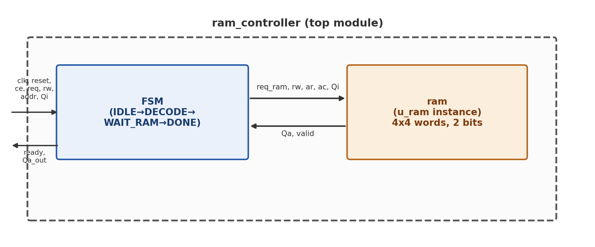
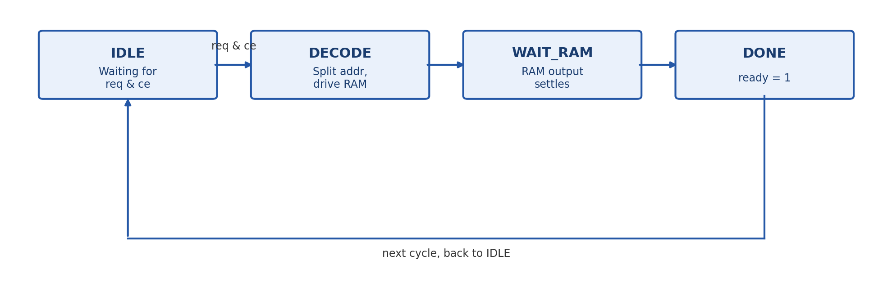
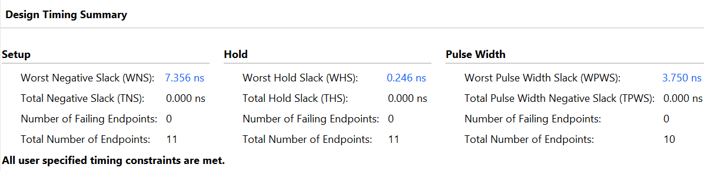

# Memory Controller & Single-Port RAM (Verilog)

**VLSI System Design Track — STPVD-2025 Project**

A parameterized single-port RAM paired with an FSM-based memory controller, written in Verilog, verified in simulation, and synthesized for the Xilinx Artix-7 (`xc7a100tcsg324-1`, as used on the Digilent Nexys 4 DDR).

The controller presents a simple address-based interface (`addr`, `Qi`, `ready`, `Qa_out`) to the outside world, internally sequencing a 4-state FSM to generate row/column addresses and talk to the RAM.

## Architecture



The controller is a 4-state Moore machine: a request is accepted only in `IDLE` (when `req && ce`); every other transition is unconditional. A request takes exactly 3 clock cycles from assertion to `ready`.



| State | `req_ram` | `ready` | `Qa_out` | Next state |
|---|---|---|---|---|
| `IDLE` | 0 | 0 | 0 | `DECODE` if `req && ce`, else `IDLE` |
| `DECODE` | 1 (pulsed) | 0 | 0 | `WAIT_RAM` |
| `WAIT_RAM` | 0 | 0 | 0 | `DONE` |
| `DONE` | 0 | 1 | `Qa` (from RAM) | `IDLE` |

## Parameters

| Parameter | Default | Notes |
|---|---|---|
| `R` (rows) | 4 | Row address width = `$clog2(R)` |
| `C` (columns) | 4 | Column address width = `$clog2(C)` |
| `N` (word width) | 2 bits | `Qi` / `Qa` / `Qa_out` width |
| Flat address width | 4 bits | `addr[3:2]=ar`, `addr[1:0]=ac` |
| Clock frequency | 100 MHz | 10 ns period |

Row/column address widths are derived automatically via `$clog2`, so the design scales to any `R`/`C`/`N` without further RTL changes (see [`scaled_config_R256_C8/`](scaled_config_R256_C8/) for a validated example).

## Repository Structure

```
rtl/                        Verilog source (ram.v, ram_controller.v)
tb/                          Testbenches (ram_tb.v, ram_controller_tb.v)
constraints/                 Vivado .xdc constraints (clock only; no board attached)
docs/                        Full written project report + all report screenshots
scaled_config_R256_C8/       A scaled-up (R=256, C=256, N=8) configuration,
                              demonstrating the LUTRAM-to-Block-RAM synthesis
                              crossover (see Results below)
```

## Key Design Decisions

- **`ready`** is defined as "the current operation just completed" (a one-cycle pulse), not "free to accept a new request."
- The RAM has a **registered (synchronous) read output**: data appears on `Qa` exactly one clock cycle after a read request. Address decoding itself is purely combinational.
- The controller is an **explicit 4-state FSM**, chosen deliberately over a minimal combinational design.
- **No abort/cancel path** — a request, once issued, always runs to completion.
- Reads and writes share **uniform 3-cycle timing**, even though a write logically completes as soon as the RAM samples it.
- Reset clears only the RAM's output-side registers (`Qa`, `valid`); **memory contents are left undisturbed** by reset, matching typical block RAM behavior.

Full rationale for every decision is in [`docs/VLSI_Memory_Controller_Report.docx`](docs/VLSI_Memory_Controller_Report.docx).

## Running the Simulation

Both testbenches are self-checking (pass/fail `$display` output, no manual waveform inspection required) and were verified on both Icarus Verilog and Vivado's XSIM simulator.

```bash
# RAM module in isolation
iverilog -g2005 -o ram_tb.out rtl/ram.v tb/ram_tb.v
vvp ram_tb.out

# Full controller (RAM instantiated internally)
iverilog -g2005 -o ram_controller_tb.out rtl/ram.v rtl/ram_controller.v tb/ram_controller_tb.v
vvp ram_controller_tb.out
```

Expected output: `=== ALL TESTS PASSED ===` for both.

## Synthesis

- **Tool:** Xilinx Vivado
- **Target part:** `xc7a100tcsg324-1` (Artix-7, Nexys 4 DDR)
- **Top module:** `ram_controller` (used directly; no physical board was available, so bitstream generation and the board-level I/O wrapper were out of scope)
- **Constraints:** a single clock constraint (`constraints/ram_controller_constraints.xdc`), defining the 100 MHz target

## Results

| Report | Result |
|---|---|
| Timing | All constraints met — WNS = 7.356 ns, 0 failing endpoints |
| Power | 0.092 W total, 99% static (expected for a design this small) |
| Utilization | ~6 LUTs, 7 FFs — well under 0.1% of device capacity; 16-word memory implemented as distributed LUTRAM, not Block RAM |



### Scaling experiment: the LUTRAM → Block RAM crossover

The default `R=4, C=4, N=2` configuration (32 bits of storage) is too small for Vivado to allocate a dedicated Block RAM tile, so it's implemented as distributed LUT memory. Re-parameterizing to `R=256, C=256, N=8` (512 Kbit) — with no other RTL changes, since address widths are `$clog2`-derived — causes the synthesis tool to switch decisively to dedicated Block RAM:

| Metric | R=4, C=4, N=2 | R=256, C=256, N=8 |
|---|---|---|
| Block RAM Tile used | 0 | 16 (of 135) |
| LUT as Memory | 2 | 0 |
| Setup slack (WNS) | 7.356 ns | 3.944 ns |
| Total on-chip power | 0.092 W | 0.095 W |
| Dynamic power, BRAM share | — (none used) | 40% |

See [`scaled_config_R256_C8/`](scaled_config_R256_C8/) for the full source and reports at this configuration.

## Full Report

The complete project report — architecture, full RTL listings, testbenches with simulation waveforms, synthesis schematics, and the timing/power/utilization analysis — is in [`docs/VLSI_Memory_Controller_Report.docx`](docs/VLSI_Memory_Controller_Report.docx).
